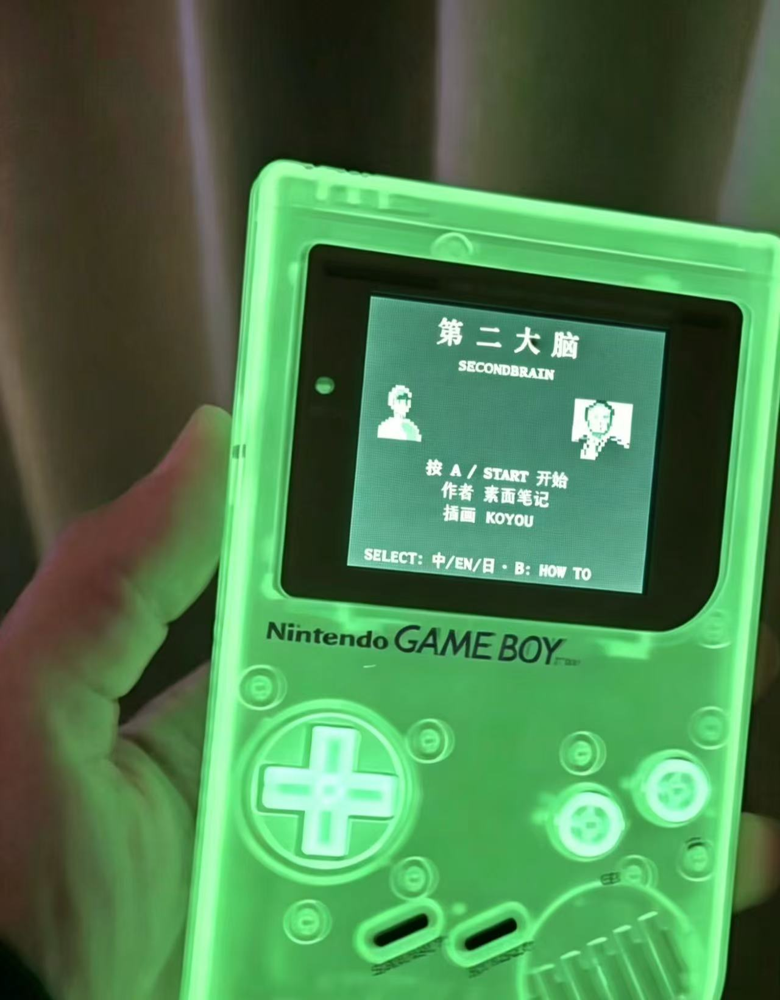

# Second Brain

*A Game Boy-style narrative game about memory, emotions, and self-discovery.*

## About

Follow Yuki from the familiar routines of city life into the quiet of the mountains. Through conversation, observation, and reflection, explore a four-tone pixel-art world and uncover a story about memory, emotions, and the paths that lead us to understand ourselves.

## Play the game

[Play Second Brain on itch.io](https://evernotebot.itch.io/secondbrain)

## Screenshots

## The experience

- **A personal journey:** Travel with Yuki from the city to the mountains.
- **A four-tone pixel-art world:** Discover the story through a distinctive, Game Boy-inspired visual style.
- **Quiet, reflective play:** Engage with the world through conversation, observation, and moments of reflection.

## Themes

Memory · Emotions · Self-discovery

---

*Second Brain is a story about slowing down, paying attention, and finding meaning in what we carry with us.*
